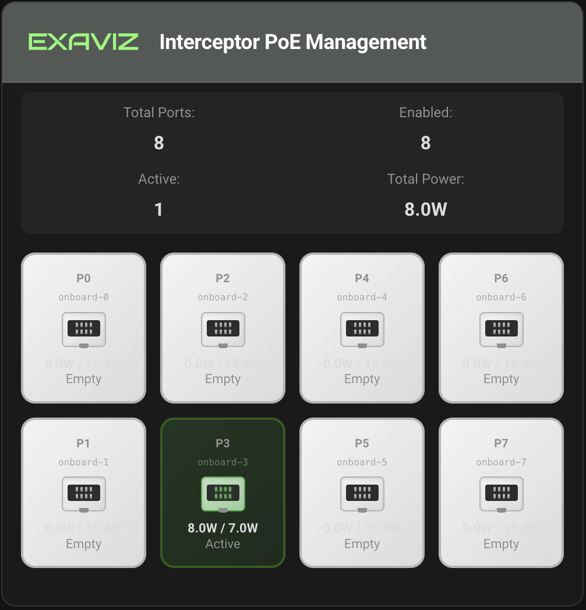
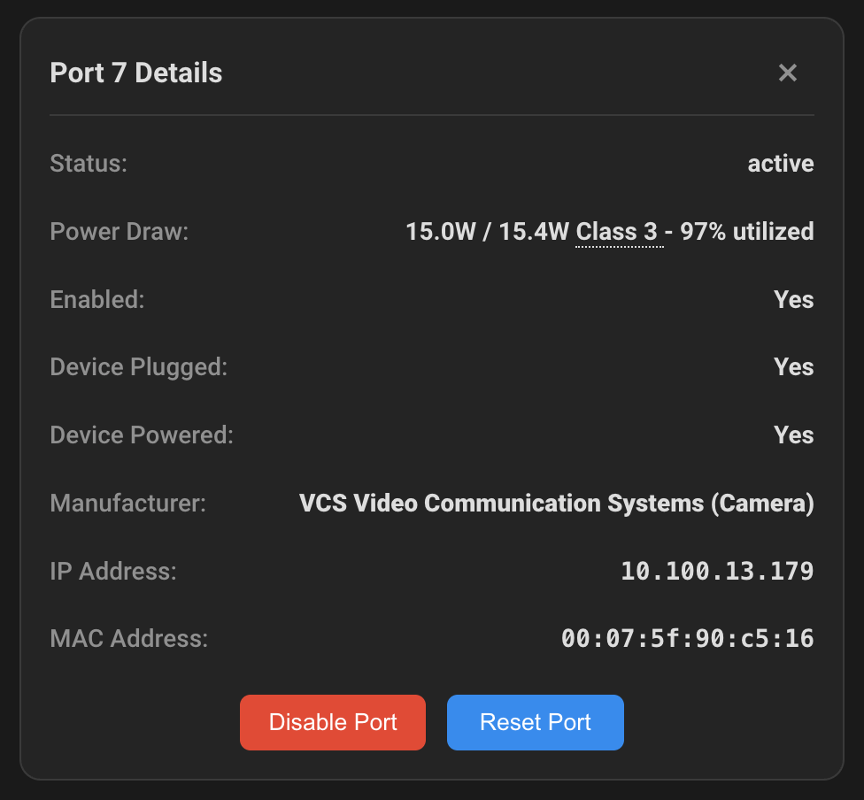
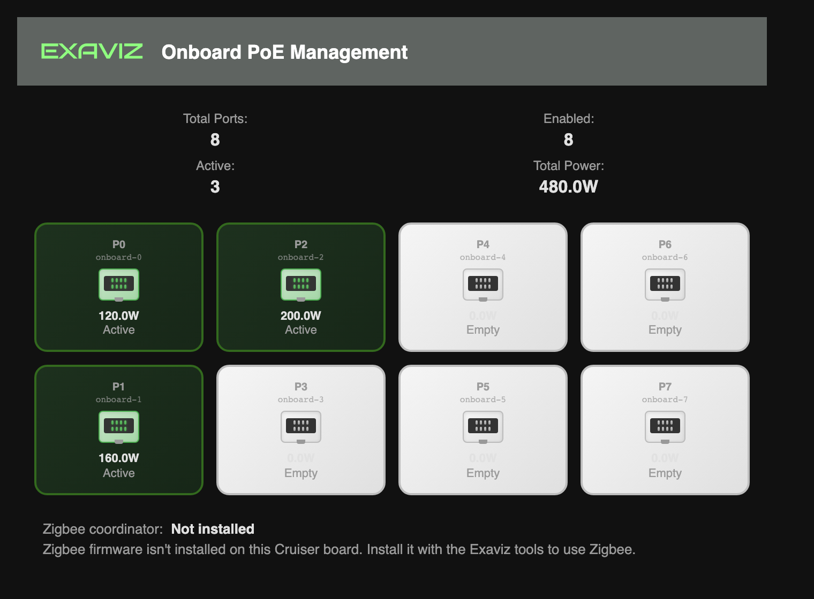

<a href="https://www.exaviz.com">
  
</a>

# Exaviz PoE Plugin for Home Assistant

**Monitor and control Power over Ethernet ports on [Exaviz](https://www.exaviz.com) hardware platforms.**

A Home Assistant custom integration for managing PoE ports on Exaviz Interceptor
and Cruiser carrier boards. Run Home Assistant on the board itself, with no setup
beyond adding the integration, or on another computer that reaches a Cruiser over
your network. No cloud or external servers.



Click any port tile to see detailed information:



## Features

- **Zero Configuration** -- Automatically detects board type and all PoE systems
- **Real-time Monitoring** -- Port status, power consumption, connected devices
- **PoE Port Control** -- Enable/disable individual PoE ports
- **Device Discovery** -- Identifies connected devices by IP, MAC, and manufacturer
- **Zigbee Coordinator Status** -- Cruiser only: shows whether the ESP32-C6 has Zigbee firmware, with a helper message when it does not
- **Modern Dashboard** -- Lovelace card with dark/light theme support
- **Multi-language** -- 10 languages for setup on the board (EN, DE, ES, FR, IT, JA, KO, NL, PT-BR, ZH); setup for a board on the network is in English for now

## Supported Hardware

| Board | Onboard PoE | Add-on PoE | Max Ports |
|-------|-------------|------------|-----------|
| **Cruiser** (CM5) | 4 or 8 ports @ 1GbE | 1 add-on board (8 ports) | 16 |
| **Interceptor** (CM4/CM5) | None | Up to 2 add-on boards (8 ports each) | 16 |

## Requirements

These are for Home Assistant running on the Exaviz board. For Home Assistant on another
computer, see [Home Assistant on another computer](#home-assistant-on-another-computer).

- Exaviz Cruiser or Interceptor board with PoE support
- Debian-based Linux (Bookworm or Trixie) -- e.g., Raspberry Pi OS via Imager
- **[exaviz-dkms](https://exa-pedia.com/docs/software/apt-repository/)** package installed (kernel modules, device tree overlays)
- **[exaviz-netplan](https://exa-pedia.com/docs/software/apt-repository/)** package installed (per-port network configuration)
- **[exaviz-poe-tool](https://exa-pedia.com/docs/software/apt-repository/)** package installed (PoE monitoring utility)
- Home Assistant 2024.12+ ([Docker Container](https://www.home-assistant.io/installation/linux#install-home-assistant-container) recommended)
- [HACS](https://hacs.xyz/) (Home Assistant Community Store)

> **Note:** The `exaviz-dkms`, `exaviz-netplan`, and `exaviz-poe-tool` packages are
> required on **all** board types (Cruiser and Interceptor). Install them from the
> [Exaviz apt repository](https://exa-pedia.com/docs/software/apt-repository/).
>
> The deprecated pre-built Exaviz OS images are **not supported** by this plugin.
> Use a standard Debian-based OS with the Exaviz packages instead.

## Quick Start

### 0. Install Exaviz packages on the host OS

```bash
# Add the Exaviz apt repository (one-time setup)
curl -fsSL https://apt.exaviz.com/KEY.gpg \
  | sudo gpg --dearmor -o /usr/share/keyrings/exaviz-archive-keyring.gpg
DISTRO=$(lsb_release -cs 2>/dev/null || grep VERSION_CODENAME /etc/os-release | cut -d= -f2)
echo "deb [arch=arm64 signed-by=/usr/share/keyrings/exaviz-archive-keyring.gpg] https://apt.exaviz.com ${DISTRO} main" \
  | sudo tee /etc/apt/sources.list.d/exaviz.list

# Install required packages
sudo apt update
sudo apt install exaviz-dkms exaviz-netplan exaviz-poe-tool

# Reboot to load kernel modules and device tree overlays
sudo reboot
```

### 1. Install via HACS

1. Open HACS in Home Assistant
2. Search for "**Exaviz**"
3. Click on **Exaviz PoE Plugin** and click **Download**
4. Restart Home Assistant

> **Tip:** If you need a version that isn't in the default HACS store (e.g., a
> pre-release or development branch), you can add this repository as a
> **Custom repository** instead:
> `https://github.com/exavizco/ha-poe-plugin`

### 2. Add the Integration

1. Go to **Settings > Devices & Services**
2. Click **+ Add Integration**
3. Search for "**Exaviz**"
4. Choose **Home Assistant runs on this board**
5. The integration auto-detects your board and PoE systems -- no configuration needed

### 3. Add the Dashboard Card

1. Edit a dashboard and click **+ Add Card**
2. Search for "**Exaviz PoE**"
3. The card auto-detects your PoE configuration and displays ports for the selected set
4. For boards with multiple PoE sets (e.g., Cruiser onboard + add-on, or dual Interceptor),
   add one card per set

### 4. Check Zigbee Status (Cruiser only)

The Cruiser's ESP32-C6 can act as a Zigbee coordinator, but only when the Zigbee firmware
is installed. The integration adds a **Zigbee Coordinator** binary sensor
(`binary_sensor.zigbee_coordinator`) that reports which firmware is running:

| State | Meaning |
|-------|---------|
| **On** | Zigbee firmware is installed |
| **Off** | Zigbee firmware is not installed. The sensor's `message` attribute explains what to do |
| **Unknown** | The ESP32 firmware is too old to report its variant |

The `firmware_variant` attribute names the firmware the board reported (absent when the
state is unknown). The PoE card shows the same status under the port grid ("Zigbee
coordinator: Firmware installed", or "Not installed" plus the helper message). The line is
hidden when the state is unknown or unavailable. Interceptor boards have no Zigbee coordinator and get no sensor.




*Screenshots show sample data, not a live board.*

The firmware variant is read when Home Assistant starts. After installing the Zigbee
firmware, restart Home Assistant or reload the integration to refresh the status.

To install the Zigbee firmware, run `sudo exaviz-flash zigbee` once on the board. It reboots
the board once and finishes by itself in about five minutes. Setup steps, the antenna you need
and troubleshooting are on the [Zigbee page](https://exa-pedia.com/docs/cruiser/zigbee/).

## Home Assistant on another computer

If Home Assistant runs somewhere other than the Exaviz board, for example on a mini PC or in a
container on your server, the integration can reach the board over your network. The computer
that runs Home Assistant does not need the Exaviz packages.

**What you need**

- An Exaviz Cruiser. Interceptor boards cannot be added over the network yet.
- Exaviz Management on the board, with Home Assistant pairing (More > Home Assistant in the
  board's dashboard). If the board's Exaviz Management is too old, the integration tells you to
  update it.
- One board per Home Assistant for now.

**Add the board**

1. In Home Assistant, go to Settings > Devices & services > Add integration > Exaviz, and choose
   **The board is another device on my network**.
2. Enter the board's IP address. A `.local` name works only where your system resolves it; use
   the IP address if it does not.
3. On the board, open More > Home Assistant and click **Add Home Assistant**. Choose
   **Read + PoE control** if you want to switch ports from Home Assistant, or **Read only** if
   you only want to watch them. The code is valid for 5 minutes.
4. Compare the fingerprint Home Assistant shows with the one on the board's pairing screen. Tick
   the box only if they are the same.
5. Enter the 8-character code.

**Good to know**

- The integration talks to the board over HTTPS only and checks the board's certificate on every
  connection, before it sends anything. A board with a certificate from a public certificate
  authority may renew it with the same key. Any other change makes Home Assistant ask you to pair
  again, and it shows the new fingerprint first.
- With **Read only**, the port switches and reset buttons are unavailable.
- Home Assistant keeps the pairing token in its configuration files and backups as plain text,
  not encrypted. Anyone who can read your Home Assistant configuration can read it.
- Removing the integration does not revoke the token. Revoke it on the board in
  More > Home Assistant.
- Each new pairing creates a new token, and the board holds at most 20. After pairing again,
  revoke the old token on the board; Home Assistant shows its id.
- If the board moves to a new address, use Reconfigure on the Exaviz integration.
- If the board's serial number changed, delete the integration and add it again. The default
  entity ids stay the same; renames you made in Home Assistant must be made again.
- A port whose readings stop updating shows as unavailable. The PoE card currently shows such a
  port as empty.

Full guide: [Home Assistant on another computer](https://exa-pedia.com/docs/home-assistant/remote-board/).

## Options

Settings > Devices & services > Exaviz > Configure:

- **Update Interval** -- how often the integration reads the ports, 10 to 300 seconds (default 30).
- **Switch-mode device discovery** -- on a board running Home Assistant itself, in switch/bridge
  mode, find the device on each PoE port. Leave it off in per-port mode. Not shown for a board on
  the network.

## Actions

| Action | What it does |
|--------|--------------|
| `exaviz.turn_on_port` | Turn PoE power on for a port (`entity_id` of its switch) |
| `exaviz.turn_off_port` | Turn PoE power off for a port |
| `exaviz.toggle_port` | Toggle PoE power for a port |
| `exaviz.control_port` | Same, with `action`: `turn_on`, `turn_off` or `toggle` |
| `exaviz.reset_port` | Power-cycle a port |
| `exaviz.refresh_data` | Read the ports now |

The port switches and reset buttons work with Home Assistant's own `switch` and `button` actions too.

If a port command does not complete (the PoE power or the port's network link), the action fails
with an error that says what happened.

Ports on add-on PoE boards (Interceptor, and the Cruiser's add-on board) can be read but not
switched or reset yet: their switches and reset buttons show as unavailable.

## Removing the integration

1. Settings > Devices & services > Exaviz > the three dots > **Delete**.
2. For a board on the network, revoke its token on the board in More > Home Assistant.
3. To remove the files too, remove **Exaviz PoE Management** in HACS and restart Home Assistant.

## Documentation

Full documentation is available at **[exa-pedia.com](https://exa-pedia.com/docs/home-assistant/)**:

- [Installation Guide](https://exa-pedia.com/docs/home-assistant/installation/)
- [Configuration](https://exa-pedia.com/docs/home-assistant/configuration/)
- [Home Assistant on another computer](https://exa-pedia.com/docs/home-assistant/remote-board/)
- [Dashboard Setup](https://exa-pedia.com/docs/home-assistant/dashboard/)
- [Troubleshooting](https://exa-pedia.com/docs/home-assistant/troubleshooting/)
- [FAQ](https://exa-pedia.com/docs/home-assistant/faq/)

## Development

### Project Structure

```
custom_components/exaviz/    # Home Assistant integration (Python)
lovelace-cards/              # Frontend Lovelace card (TypeScript)
tests/                       # Test suite
```

### Running Tests

```bash
pip install -e ".[dev]"
pytest tests/ -v
```

### Building Frontend

```bash
cd lovelace-cards
npm ci
npm run build
```

## Links

- **Website:** [www.exaviz.com](https://www.exaviz.com)
- **Documentation:** [www.exa-pedia.com](https://www.exa-pedia.com)
- **Support:** [support@exaviz.com](mailto:support@exaviz.com)

## License

MIT License - see [LICENSE](LICENSE) for details.

Copyright (c) 2026 Axzez LLC (aka Exaviz)
