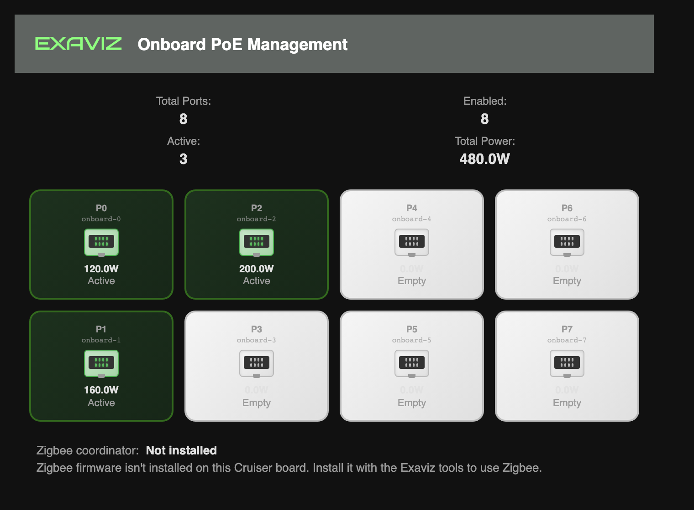

<a href="https://www.exaviz.com">
  
</a>

# Exaviz PoE Plugin for Home Assistant

**Monitor and control Power over Ethernet ports on [Exaviz](https://www.exaviz.com) hardware platforms.**

A zero-configuration Home Assistant custom integration for managing PoE ports on
Exaviz Interceptor and Cruiser carrier boards. Runs directly on the board --
no external servers required.


Click any port tile to see detailed information:


## Features

- **Zero Configuration** -- Automatically detects board type and all PoE systems
- **Real-time Monitoring** -- Port status, power consumption, connected devices
- **PoE Port Control** -- Enable/disable individual PoE ports
- **Device Discovery** -- Identifies connected devices by IP, MAC, and manufacturer
- **Zigbee Coordinator Status** -- Cruiser only: shows whether the ESP32-C6 has Zigbee firmware, with a helper message when it does not
- **Modern Dashboard** -- Lovelace card with dark/light theme support
- **Multi-language** -- 10 languages included (EN, DE, ES, FR, IT, JA, KO, NL, PT-BR, ZH)

## Supported Hardware

| Board | Onboard PoE | Add-on PoE | Max Ports |
|-------|-------------|------------|-----------|
| **Cruiser** (CM5) | 4 or 8 ports @ 1GbE | 1 add-on board (8 ports) | 16 |
| **Interceptor** (CM4/CM5) | None | Up to 2 add-on boards (8 ports each) | 16 |

## Requirements

- Exaviz Cruiser or Interceptor board with PoE support
- Debian-based Linux (Bookworm or Trixie) -- e.g., Raspberry Pi OS via Imager
- **[exaviz-dkms](https://exa-pedia.com/docs/software/apt-repository/)** package installed (kernel modules, device tree overlays)
- **[exaviz-netplan](https://exa-pedia.com/docs/software/apt-repository/)** package installed (per-port network configuration)
- **[exaviz-poe-tool](https://exa-pedia.com/docs/software/apt-repository/)** package installed (PoE monitoring utility)
- Home Assistant 2024.12+ ([Docker Container](https://www.home-assistant.io/installation/linux#install-home-assistant-container) recommended)
- [HACS](https://hacs.xyz/) (Home Assistant Community Store)

> **Note:** The `exaviz-dkms`, `exaviz-netplan`, and `exaviz-poe-tool` packages are
> required on **all** board types (Cruiser and Interceptor). Install them from the
> [Exaviz apt repository](https://exa-pedia.com/docs/software/apt-repository/).
>
> The deprecated pre-built Exaviz OS images are **not supported** by this plugin.
> Use a standard Debian-based OS with the Exaviz packages instead.

## Quick Start

### 0. Install Exaviz packages on the host OS

```bash
# Add the Exaviz apt repository (one-time setup)
curl -fsSL https://apt.exaviz.com/KEY.gpg \
  | sudo gpg --dearmor -o /usr/share/keyrings/exaviz-archive-keyring.gpg
DISTRO=$(lsb_release -cs 2>/dev/null || grep VERSION_CODENAME /etc/os-release | cut -d= -f2)
echo "deb [arch=arm64 signed-by=/usr/share/keyrings/exaviz-archive-keyring.gpg] https://apt.exaviz.com ${DISTRO} main" \
  | sudo tee /etc/apt/sources.list.d/exaviz.list

# Install required packages
sudo apt update
sudo apt install exaviz-dkms exaviz-netplan exaviz-poe-tool

# Reboot to load kernel modules and device tree overlays
sudo reboot
```

### 1. Install via HACS

1. Open HACS in Home Assistant
2. Search for "**Exaviz**"
3. Click on **Exaviz PoE Plugin** and click **Download**
4. Restart Home Assistant

> **Tip:** If you need a version that isn't in the default HACS store (e.g., a
> pre-release or development branch), you can add this repository as a
> **Custom repository** instead:
> `https://github.com/exavizco/ha-poe-plugin`

### 2. Add the Integration

1. Go to **Settings > Devices & Services**
2. Click **+ Add Integration**
3. Search for "**Exaviz**"
4. The integration auto-detects your board and PoE systems -- no configuration needed

### 3. Add the Dashboard Card

1. Edit a dashboard and click **+ Add Card**
2. Search for "**Exaviz PoE**"
3. The card auto-detects your PoE configuration and displays ports for the selected set
4. For boards with multiple PoE sets (e.g., Cruiser onboard + add-on, or dual Interceptor),
   add one card per set

### 4. Check Zigbee Status (Cruiser only)

The Cruiser's ESP32-C6 can act as a Zigbee coordinator, but only when the Zigbee firmware
is installed. The integration adds a **Zigbee Coordinator** binary sensor
(`binary_sensor.zigbee_coordinator`) that reports which firmware is running:

| State | Meaning |
|-------|---------|
| **On** | Zigbee firmware is installed |
| **Off** | Zigbee firmware is not installed. The sensor's `message` attribute explains what to do |
| **Unknown** | The ESP32 firmware is too old to report its variant |

The `firmware_variant` attribute names the firmware the board reported (absent when the
state is unknown). The PoE card shows the same status under the port grid ("Zigbee
coordinator: Firmware installed", or "Not installed" plus the helper message). The line is
hidden when the state is unknown or unavailable. Interceptor boards have no Zigbee coordinator and get no sensor.




The firmware variant is read when Home Assistant starts. After installing the Zigbee
firmware, restart Home Assistant or reload the integration to refresh the status.

To install the Zigbee firmware, run `sudo exaviz-flash zigbee` on the board (two runs with
a reboot between them). See the
[Cruiser Zigbee guide](https://exa-pedia.com/docs/cruiser/zigbee/) for the full steps.

## Documentation

Full documentation is available at **[exa-pedia.com](https://exa-pedia.com/docs/home-assistant/)**:

- [Installation Guide](https://exa-pedia.com/docs/home-assistant/installation/)
- [Configuration](https://exa-pedia.com/docs/home-assistant/configuration/)
- [Dashboard Setup](https://exa-pedia.com/docs/home-assistant/dashboard/)
- [Zigbee on the Cruiser](https://exa-pedia.com/docs/cruiser/zigbee/)
- [Troubleshooting](https://exa-pedia.com/docs/home-assistant/troubleshooting/)
- [FAQ](https://exa-pedia.com/docs/home-assistant/faq/)

## Development

### Project Structure

```
custom_components/exaviz/    # Home Assistant integration (Python)
lovelace-cards/              # Frontend Lovelace card (TypeScript)
tests/                       # Test suite
```

### Running Tests

```bash
pip install -e ".[dev]"
pytest tests/ -v
```

### Building Frontend

```bash
cd lovelace-cards
npm ci
npm run build
```

## Links

- **Website:** [www.exaviz.com](https://www.exaviz.com)
- **Documentation:** [www.exa-pedia.com](https://www.exa-pedia.com)
- **Support:** [support@exaviz.com](mailto:support@exaviz.com)

## License

MIT License - see [LICENSE](LICENSE) for details.

Copyright (c) 2026 Axzez LLC (aka Exaviz)
